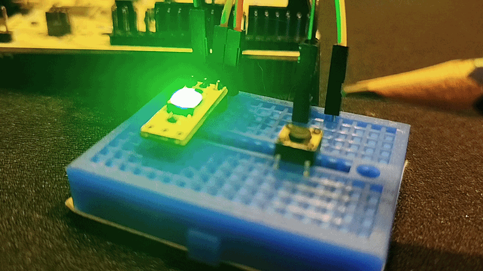

# Zadanie 2.1

Kod został przetestowany na NUCLEO-G474RE, co dokumentuje poniższy gif nagrany tosterem:

---

W folderze **Documentation** znajduje się datasheet WS2812, na którym wzorowałem się przy pisaniu drivera. Są tam również zrzuty ekranu z oscyloskopu pokazujące sygnał idący do WS2812.