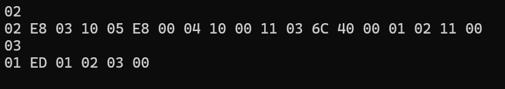

# Zadanie 2.1

Kod został przetestowany na NUCLEO-G474RE.

Piny RX i TX są połączone razem, więc STM32 odpowiada sam sobie.
Komunikacja ta jest podsłuchana przy pomocy konwertera USB-UART.

---

Dane odczytane z konwertera UART przy pomocy skryptu w pythonie, aby wyświetlać bajty w postaci hex:

Widzimy tutaj:

- 02 (PING) 02 (długość) E8 03 (0x03E8 = 1000[ms])
- 10 (MATH) 05 (długość) E**8** (b1000 - dzielenie) 00 04 (0x0400 = 1024) 10 00 (0x0010 = 16)
- 11 (MATH_RESP) 03 (długość) 6**C** (b1100 - overflow i divide_by_zero = 0) 40 00 (0x0040 = 64)
- 01 (ACK) 02 (długość) 11 (odp. na MATH_RESP) 00 (MSG_STATUS_OK)
- 03 (PONG) 01 (długość) ED
- 01 (ACK) 02 (długość) 03 (odp. na PONG) 00 (MSG_STATUS_OK)
